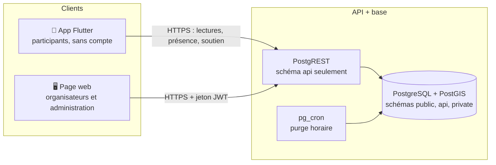
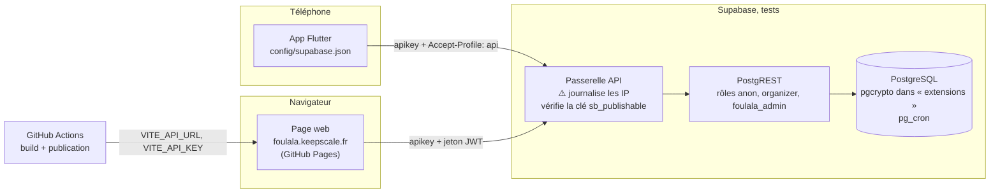
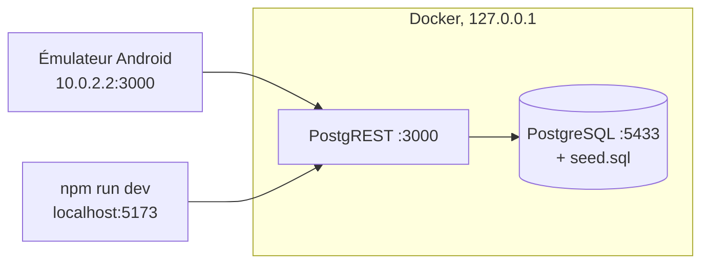
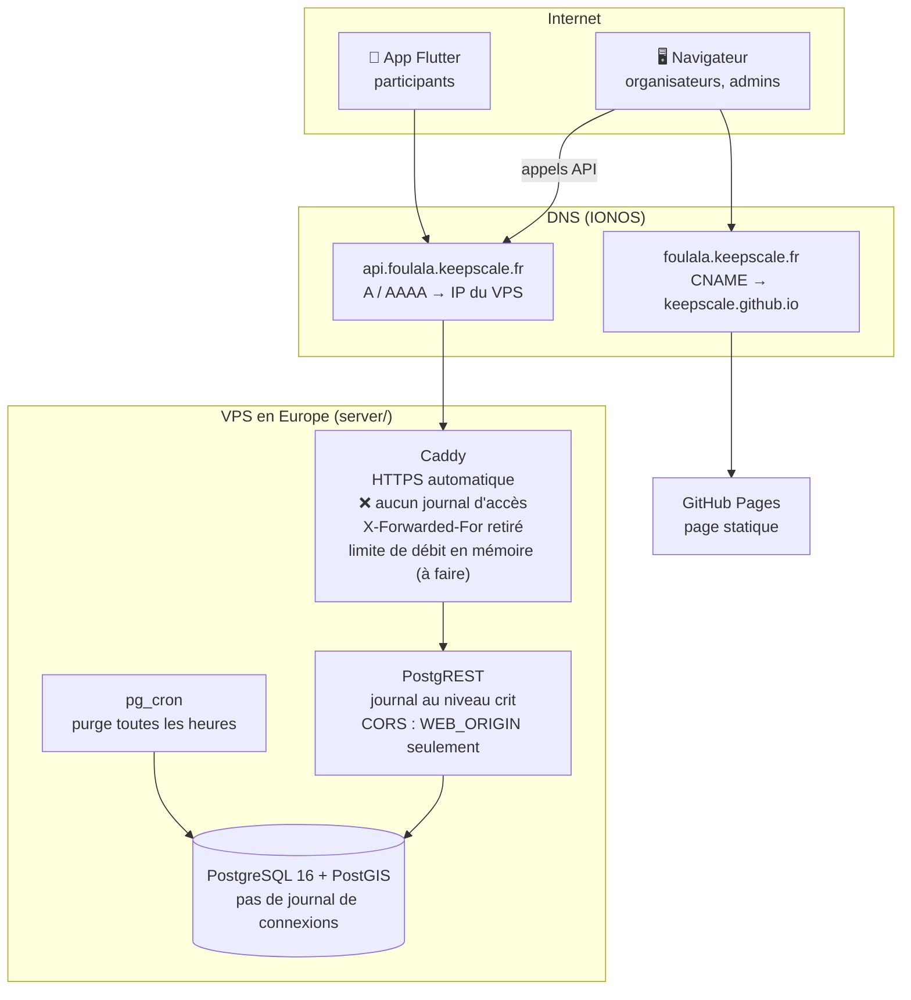
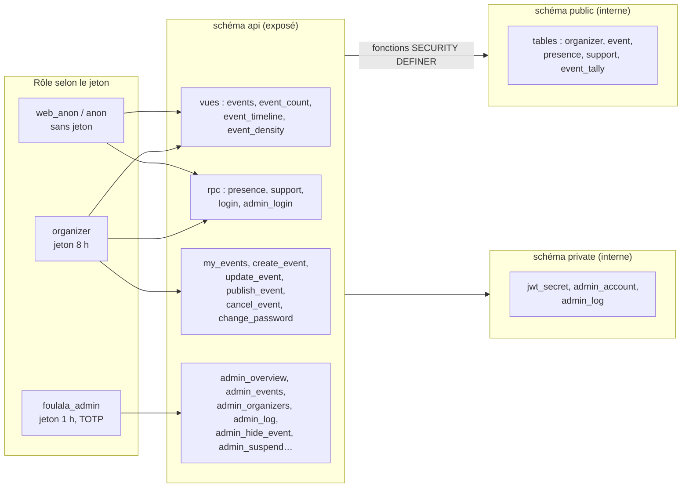
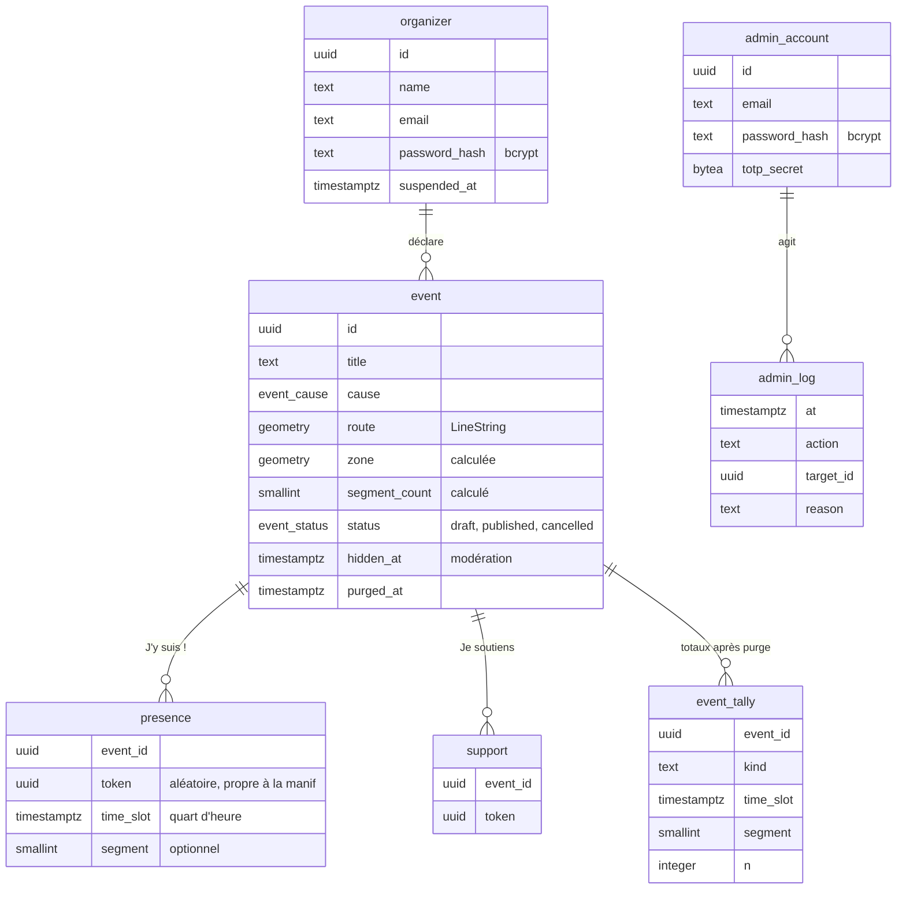
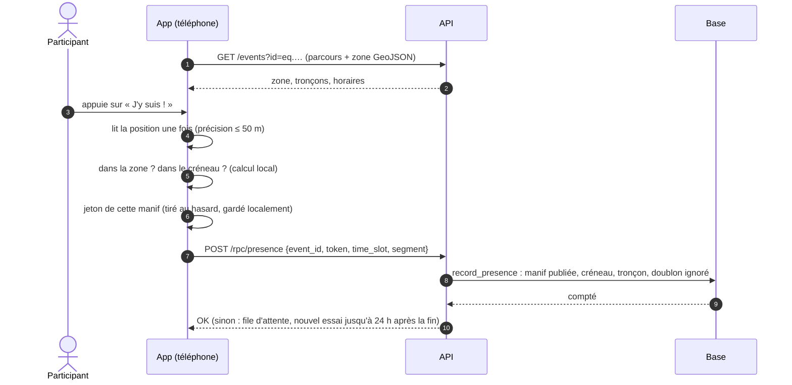
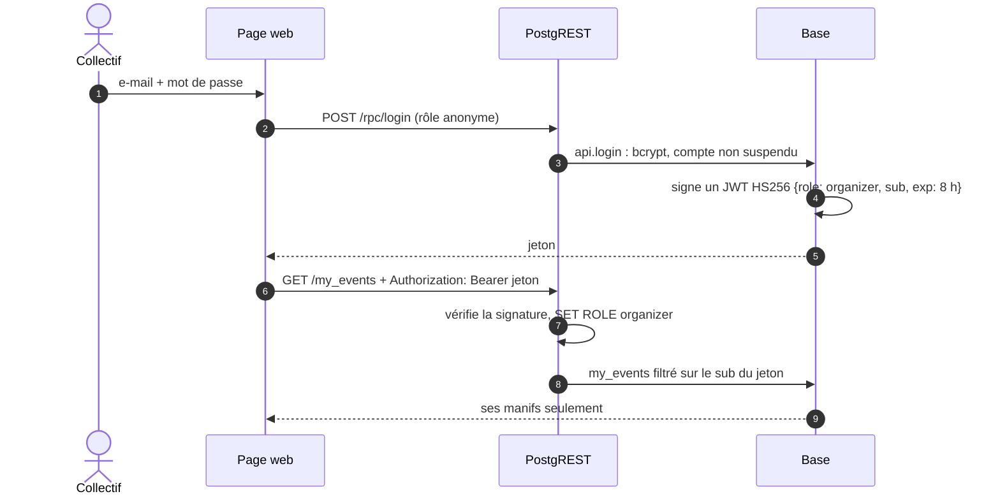
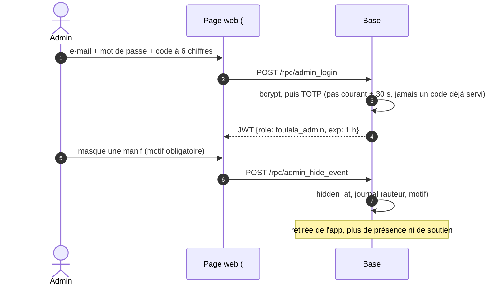
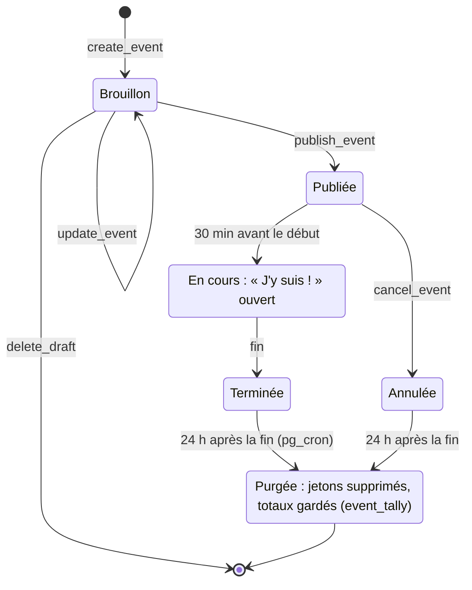

# Architecture

Comment les morceaux de Foulala s'assemblent, en **test** (Supabase) et en **production** (VPS). Les diagrammes sont en [Mermaid](https://mermaid.js.org/) : GitHub les affiche directement.

Pour les règles de vie privée qui contraignent tout ce qui suit, voir `CLAUDE.md` (invariants) et `docs/vie-privee.md`.

## Les morceaux

| Morceau | Dossier | Rôle | Qui s'en sert |
|---|---|---|---|
| App mobile | `app/` (Flutter) | Liste des manifs, « J'y suis ! », « Je soutiens », compteur | Participants, **sans compte** |
| Page web | `web/` (Vite + TypeScript) | Espace organisateur (`#/`) et administration (`#/admin`) | Collectifs invités, administrateurs |
| Base de données | `db/` (SQL) | Tables, règles métier, API, connexion, purge | Tout le monde, à travers l'API |
| Serveur | `server/` (Docker Compose) | PostgreSQL, PostgREST et Caddy sur le VPS | Production |
| Adaptation Supabase | `supabase/` | Droits et script d'installation pour la base de test | Tests |

Il n'y a **pas de code serveur applicatif** : PostgREST expose directement le schéma `api` de PostgreSQL. Toute la logique (validations, connexion, signature des jetons, purge) est en SQL, donc lisible et testée au même endroit (`db/tests/`).

## Mode test : Supabase

Pour tester entre amis sans serveur à soi : la base vit chez Supabase (offre gratuite), la page web sur GitHub Pages.

> **Supabase journalise les adresses IP** dans sa passerelle. Une IP reliée à une présence, c'est exactement ce que Foulala doit rendre impossible : ce mode sert aux **tests avec des données fictives**, jamais à une vraie manif. La page web affiche un bandeau « Version de test » dès qu'elle parle à Supabase.

Particularités, toutes gérées par `scripts/supabase-bundle.sh` et `supabase/adapter.sql` :

- PostgREST s'y connecte avec le rôle **`anon`** (et non `web_anon`) : l'adaptateur lui donne exactement les mêmes droits.
- Supabase donne par défaut **tous les droits** sur `public` à `anon` et `authenticated` : l'adaptateur les retire, active RLS sans politique sur toutes les tables, puis vérifie que rien ne reste exposé.
- `pgcrypto` est dans le schéma `extensions` : le bundle l'ajoute au `search_path` des fonctions.
- Les jetons des organisateurs et des admins sont signés en SQL avec le **secret JWT du projet Supabase**, rangé à la main dans `private.jwt_secret` : c'est le seul moyen pour que l'API de Supabase les accepte.
- Toutes les requêtes portent la clé publique (`apikey`) et le schéma (`Accept-Profile: api`), car Supabase expose plusieurs schémas.

Installation pas à pas : `supabase/README.md`.

### Variante locale (développement au quotidien)

Sans réseau ni Supabase : `server/docker-compose.dev.yml` lance la base et l'API sur `127.0.0.1:3000`, avec les données de `db/seed.sql`. L'émulateur Android la voit en `10.0.2.2:3000`, la page web en `npm run dev` (`localhost:5173`, seule origine autorisée par CORS). Aucune IP n'est journalisée, comme en production.

## Mode production : VPS

Un petit VPS en Europe (Hetzner ou OVH, 6 à 8 € par mois) fait tourner `server/` : trois conteneurs, aucun service tiers devant l'API. La page web reste un site statique sur GitHub Pages ; seuls les organisateurs la visitent.

Ce qui garantit l'absence de journal d'IP sur la chaîne participant (invariant n° 4) :

| Maillon | Réglage |
|---|---|
| Caddy | pas de directive `log`, en-têtes `X-Forwarded-For` et `X-Real-IP` retirés avant PostgREST |
| PostgREST | `PGRST_LOG_LEVEL=crit` |
| PostgreSQL | `log_connections` et `log_statement` désactivés |
| Réseau | pas de CDN ni de proxy tiers (Cloudflare…) devant l'API |

## Test et production côte à côte

| | Test (Supabase) | Production (VPS) |
|---|---|---|
| Hébergement de la base | Supabase, offre gratuite | VPS européen, `server/` |
| Adresse de l'API | `https://<projet>.supabase.co/rest/v1` | `https://api.foulala.keepscale.fr` |
| Journal des adresses IP | **oui** (passerelle Supabase) | **non**, sur toute la chaîne |
| Rôle anonyme de l'API | `anon` | `web_anon` |
| Clé dans les requêtes | `apikey: sb_publishable_…` | aucune |
| Secret des jetons JWT | secret du projet Supabase, copié dans `private.jwt_secret` | `JWT_SECRET` de `server/.env`, chargé au premier démarrage |
| CORS | toutes origines (Supabase) | `WEB_ORIGIN` seulement |
| Purge horaire | pg_cron de Supabase | pg_cron du conteneur |
| Installation de la base | coller `supabase/build/setup.sql` | automatique au premier `docker compose up` |
| Données | fictives uniquement | réelles |
| Bandeau « Version de test » | oui | non |

Configuration de chaque client :

| | App Flutter | Page web |
|---|---|---|
| Test | `--dart-define-from-file=config/supabase.json` (`API_URL`, `API_KEY`) | variables GitHub `API_URL`, `API_KEY` |
| Production | `--dart-define=API_URL=https://api.foulala.keepscale.fr` | variable GitHub `API_URL` seule |
| Local | par défaut (`10.0.2.2:3000`) | `npm run dev` (`localhost:3000`) |

## Dans la base : schémas et rôles

- Les rôles n'ont **aucun droit sur les tables** : tout passe par des vues et des fonctions du schéma `api`, qui vérifient l'organisateur (`sub` du jeton) ou l'administrateur à chaque appel.
- Un compte suspendu ou un admin désactivé perd ses droits **immédiatement**, même avec un jeton encore valide.
- L'administration ne lit jamais `presence` ni `support` ligne par ligne : seulement des totaux.

### Modèle de données

`presence` et `support` n'ont volontairement **ni heure exacte, ni `created_at`, ni identifiant d'appareil**. `admin_account` et `admin_log` sont dans le schéma `private`.

## Les parcours

### « J'y suis ! »

La position est lue **une fois** et ne quitte jamais le téléphone. Le serveur ne reçoit que quatre champs.

### Connexion d'un organisateur

### Connexion d'un administrateur

Même mécanisme, avec un **code TOTP** (appli d'authentification) calculé et vérifié en SQL ; un code ne sert qu'une fois, le jeton dure une heure. Les comptes admin se créent uniquement en ligne de commande (`public.create_admin`).

## Cycle de vie d'une manif et de ses données

À tout moment après la publication, l'administration peut **masquer** une manif (retirée de l'app, plus de présence ni de soutien, motif visible du collectif) puis la **rétablir**. Le masquage ne change pas le cycle de purge.

Ce que deviennent les données d'un participant :

| Moment | Sur le téléphone | Sur le serveur |
|---|---|---|
| « J'y suis ! » | position lue une fois, jamais gardée ; jeton de la manif | jeton, quart d'heure, tronçon |
| Pas de réseau | présence en file d'attente | rien |
| 24 h après la fin | file abandonnée | jetons supprimés, remplacés par des totaux |
| Affichage | — | aucun groupe de moins de 20 personnes (tronçon × quart d'heure) |
